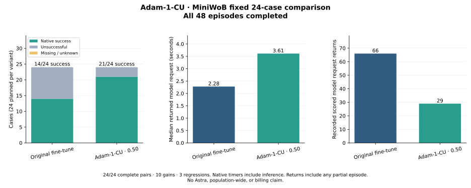
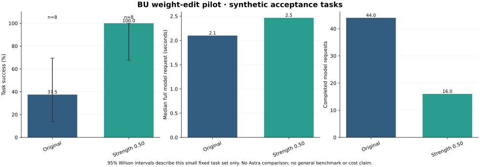

# Weight Space Lab

An experimental framework for proposing, applying and measuring reversible model-weight edits. Developers select the **editor model** independently from the **target checkpoint**, then supply an architecture-compatible recipe, evaluator, measurable goal, regression limits and resource budget. See [`framework/`](framework/) for the generic contracts, plugin registry, execution engine and OpenAI/Gemini proposal adapters. Provider integrations are protocol-tested with fake transports; live editor API access is not yet validated.

The first real target is **Grupa Adam-1**, with **Adam-1-CU** as the current experimental computer-use variant. It derives from the owner's fine-tuned Browser Use model. **Eden** remains the separate original-architecture project. These names do not erase upstream provenance or establish broader capabilities. See [`models/adam-1-cu.json`](models/adam-1-cu.json).

The current real-model experiment compares an explicit weight edit against the unchanged checkpoint, within a total Modal testing budget of $30. Generic domains are supported through registered adapters; arbitrary architectures and goals are not automatically executable or guaranteed to improve.

**The fixed MiniWoB subset improved from 14/24 to 21/24 successes, with 10 paired gains and 3 regressions.** Both variants completed all 24 cases under the original task timers. Scored requests fell from 66 to 29, while median full request latency increased from 2.28 to 3.61 seconds. The 626-check independent saved-result audit reconciles source, runtime, initial states, weight transitions and all 97 requests including two warmups. The candidate fails a strict zero-regression goal and remains experimental. See [`evidence/private_miniwob_v2_outcome.json`](evidence/private_miniwob_v2_outcome.json).

This is one DOM-assisted 12-family, two-seed subset, not the full MiniWoB benchmark or a desktop evaluation. Scores describe the model, adapter and runtime together. Native timers include inference, and two original-model failures include the adapter's rejection of repeated clearing of nonempty inputs. No Astra comparison, general capability transfer, faster decoding or cost-at-scale result is established.



**A narrow weight-edit improvement is now measured; no Astra comparison or broad superiority is established.** With fine-tune strength reduced to 0.5, success improved from 3/8 to 8/8 development tasks, then from 3/8 to 8/8 on eight separate acceptance variants of the same task families. Acceptance requests fell from 44 to 16 and aggregate task time from 100.99 to 45.87 seconds. Five repetitive-action failures were rescued, with zero observed regressions. The independent saved-result audit reconciles all 48 episodes and 177 model requests. See `evidence/vllm_v4_outcome.json` and its independent review.

This is a small synthetic DOM-assisted suite. It supports a broader benchmark, not a world-best or 10× Astra claim. Reduced repetition explains lower total task time; faster token-generation kernels have not been shown. The adapter-subtracted diagnostic control also passed 8/8 development cases, so the result may reflect undoing a harmful fine-tuning effect rather than adding new capability. It is not verified to reconstruct raw BU.

Earlier failures remain preserved: v1 loaded the checkpoint but returned four incomplete/malformed replies and timed out on call five; v2 failed its remote import path; v3 returned complete action batches that the single-action harness rejected. V4 evaluates baseline and all edits under the same corrected batch interface. All 75 local tests passed, actual CPU admission passed, and the GPU child exited normally. No historical failure was rescored as a pass.



## Model provenance

The recovered Modal artifacts are a merged `Qwen3VLMoeForConditionalGeneration` checkpoint and an ordinary rank-16 attention LoRA whose configuration names `browser-use/bu-30b-a3b-preview`. BU itself derives from Qwen3-VL-30B-A3B-Instruct. This is separate from the owner's Qwen2.5-7B experiment.

Original volumes are read-only. Private checkpoints, training data, screenshots and raw run receipts are excluded from Git. Source and artifact fingerprints live in `evidence/`; detailed local receipts remain in ignored directories.

## Initial intervention

For each original target matrix `W*`, test `BF16(FP32(W*) + (lambda - 1) * 2 * (FP32(B) @ FP32(A)))` using the recovered LoRA matrices. Every variant starts from retained originals. Lambda 1 restores the original bytes; lambda 0 is an adapter-subtracted control and is **not** verified to reconstruct raw BU. Candidate strengths are 0.5 and 0.75.

This tests fine-tuning strength. It does not copy another model's hidden knowledge, shrink BU's architecture or establish general capability transfer.

## Validation

```sh
PYTHONPATH=src python3 -m unittest discover -s tests -v
```

The local tests use small numerical examples and evaluator doubles; they do not run a model. Sixteen synthetic reference browser paths have separately passed CPU Chromium validation. MiniWoB's corrected CPU preflight passed all 24 paired cases, 48 resets and 48 native no-op steps, with zero model calls. It preserves the original task timers (10 seconds, or 15 seconds for the password task). The subsequent model comparison is reported above. Initial timer and pre-submission SDK failures remain recorded. No desktop result is established.

The generic framework has a separate pure test suite:

```sh
python3 -m unittest discover -s framework/tests -v
```

See `evidence/benchmark_protocol_v1.json` for the planned success, latency, cost, regression and demonstration measurements. Neal's game is a demonstration; established benchmarks provide broader coverage. A comparison with this interactive assistant must identify its tools and access differences, and cannot be labelled a verified Astra model benchmark.

The planned Neal.fun recording is currently blocked. A CPU-only navigation diagnostic observed HTTP 403 responses served through Cloudflare for both initial game frames, with `X-Frame-Options: SAMEORIGIN`; Chromium explicitly refused framing. The recovered video contains blank panes. The diagnostic made zero model calls and zero game actions, so it supplies no comparison score. No challenge interaction or browser-security change was attempted. The earlier startup and frame-loading failures remain preserved; this new trace does not retroactively establish their missing details. See [`evidence/neal_navigation_diagnostic_v1_outcome.json`](evidence/neal_navigation_diagnostic_v1_outcome.json).

The diagnostic also corrected a source-review mistake: Playwright routing does not intercept every automatic redirect. The final diagnostic observes natural redirects and stops on an observed unexpected request or refusal, without claiming that callbacks prevent network contact already made. Ten local tests and distinct source reviews cover that correction; actual HTTP and browser evidence comes from the separate completed CPU run.

## Running remote work

Modal entrypoints launch billable resources. Historical `modal_preflight.py` and `modal_pilot.py` invocations are consumed and must not be rerun under their old IDs. Check the current source admission, remaining budget and once-only run markers before any new invocation. Source timeouts and spend reservations do not constitute provider-enforced billing caps.

Eden models, datasets, evaluation and previous run approvals are outside this project.
